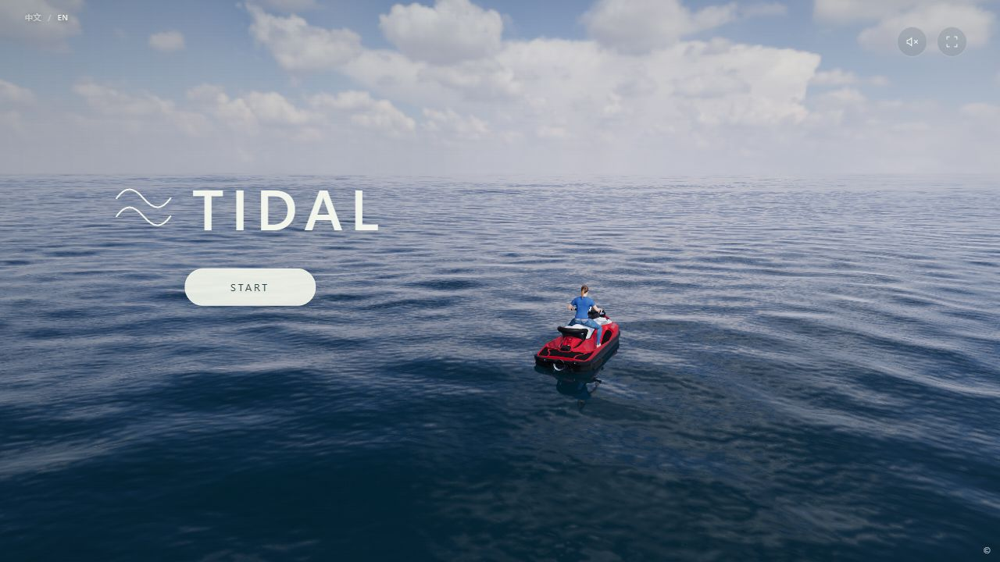
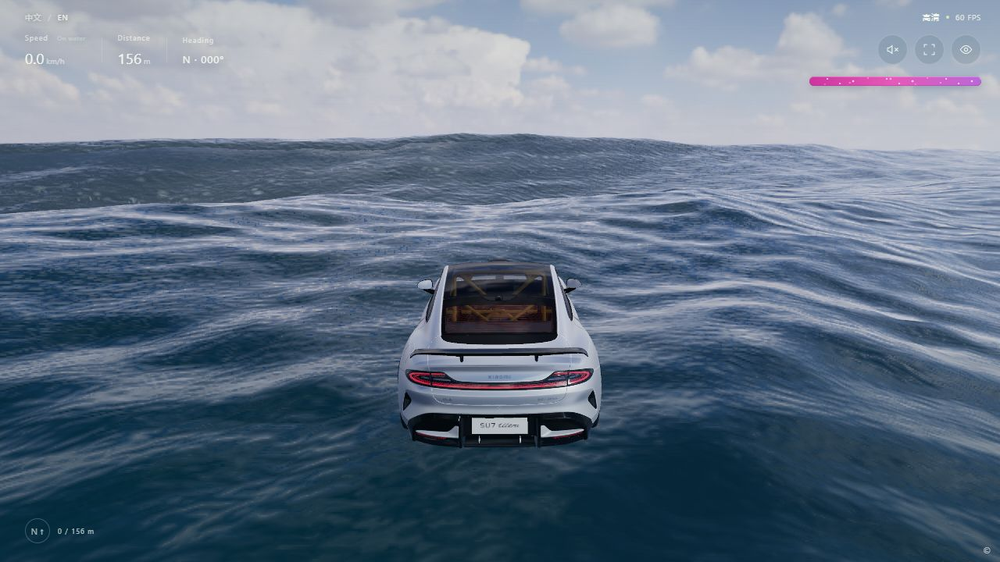

# TIDAL — Ocean Driving

A browser-based ocean-driving experiment: boats, personal watercraft and cars, massive waves, jumps, underwater travel, nitro and a local GLB model workbench.

[English](#tidal--ocean-driving) · [简体中文](#潮汐-tidal)

| Ocean & free sailing | Cars & wave riding |
| :---: | :---: |
|  |  |

Actual in-game screenshots, not pre-rendered trailers. They include third-party vehicles and characters: see [MODEL_CREDITS.md](MODEL_CREDITS.md). Their underlying assets are not independently relicensed by these screenshots.

## Private playtest

[Open the private playtest](https://tidal-isle-ru.lzy0508ok.chatgpt.site)

Owner-only: sign in with the authorized ChatGPT account. Forwarding the URL does not grant access. The [GitHub repository](https://github.com/lingziyu186-coder/Tidal-drive) is also private; repository and playtest permissions are separate.

**No public release. The project-owned-material remix policy is still an unapproved draft, not an effective licence.**

Maintainer: [lingziyu186-coder](https://github.com/lingziyu186-coder). English appears first, followed by Chinese. Original third-party licence texts remain authoritative for their respective material.

## Running and controls

Serve `index.html` with its neighbouring CSS, JavaScript, `models/`, images and licence files over HTTP/HTTPS. This is a **runtime web package, not a complete reproducible source project**, and not a `file:` double-click offline build. `game.bundle.js` combines project and third-party code; a single project licence cannot cover the whole bundle. An editable source release would need a separate cleaned source package, not the private development directory.

Vehicle keys: 1 wooden rowboat, 2 Sea-Doo, 3 Kawasaki, 4 Assault Boat, 5 Mercedes, 6 Xiaomi, 8 Jesko, 9 Aventador. Mazda (7), LEGO (0), the cat (minus) and its motions are excluded because a verifiable redistribution licence for their appearance was not established. Keys are not renumbered.

W/S forward/back · A/D steering · E/Shift nitro · Space surface drift/underwater recovery · C stop · R reset · F settings · F11 fullscreen · Esc cover · Space on the cover starts/continues. GLB workbench: F → My Models. Importing a model does not grant rights to it; check permissions before sharing models, textures, motions or configurations.

## Attribution and licensing

- [CREDITS.md](CREDITS.md): actual dependencies/adaptations, asset download sources and research-only references, with corresponding files and modifications.
- [MODEL_CREDITS.md](MODEL_CREDITS.md): creators, sources, recorded licences, modifications, sizes and SHA-256 hashes of all eight shipped GLBs. The rowboat is procedural.
- [THIRD_PARTY_NOTICES.md](THIRD_PARTY_NOTICES.md), [RDEV_GLASS_NOTICE.md](RDEV_GLASS_NOTICE.md), `licenses/`: retained notices and full third-party licence texts.
- [LICENSE_SCOPE.md](LICENSE_SCOPE.md): which terms apply to which material; this is not an all-MIT package.

This is not an official sequel to any referenced repository or an endorsement by upstream authors, asset creators or vehicle brands. Third-party code/assets are not claimed as the maintainer's original work.

The maintainer's intended policy is **credited, noncommercial reuse/remixing of material the maintainer is entitled to license**, subject to approval of the actual terms. [REMIX_POLICY_DRAFT.md](REMIX_POLICY_DRAFT.md) is not yet effective. It does not add noncommercial restrictions to third-party MIT, CC BY or CC0 material.

Third-party licences remain separate. Vehicles 6, 8 and 9 are recorded under [CC BY-NC-SA 4.0](https://creativecommons.org/licenses/by-nc-sa/4.0/); corresponding model adaptations must satisfy attribution, change notices, noncommercial use and ShareAlike. Free of charge is not automatically noncommercial. The maintainer alone cannot clear third-party assets or brands for commercial use.

Proposed attribution includes TIDAL, maintainer, actual repository URL, version/commit, portions used and your modifications, plus required upstream attribution and licence texts. The draft has a template. A private link does not grant repository access.

## Checks and limitations

Included: runtime files, shipped GLBs, two selected screenshots for this README, attribution/licence documents, the pending remix draft and `release-manifest.json` file hashes. Excluded: chats, unselected test captures, private rollback versions, platform configuration, Git history and dependency installations.

Previously, 293 regression checks and 11 release-specific checks passed. CPU geometry/animation checks skip image decoding and are not GPU playtests. The screenshots come from a basic browser cover/vehicle/wave smoke test, not an exhaustive test of every vehicle, setting or GPU. Documentation has consistency/privacy-pattern checks. No guarantee of universal GPU compatibility or absolute security is made.

Licence records rely on downloaded metadata, retained evidence and accessible upstream licence pages, not an independent verification of every uploader's rights chain, trademark, livery, design or likeness rights. Users with repository access can report concerns through Issues; no contact email is invented. Private uploading does not itself resolve asset rights.

---

# 潮汐 TIDAL

海面驾驶与冲浪实验：木船、摩托艇与汽车，支持巨浪、飞跃、潜水、氮气和本地 GLB 模型调试。

上方两列为海面自由航行、汽车冲浪的实机展示图，不是预渲染宣传图。截图含第三方载具与人物，署名及许可见 [MODEL_CREDITS.md](MODEL_CREDITS.md)，截图不能脱离这些权利单独改授许可。

## 私密试玩

[打开私密试玩](https://tidal-isle-ru.lzy0508ok.chatgpt.site)

仅所有者可访问，需要登录获授权的 ChatGPT 账号；转发链接不会授予权限。[项目仓库](https://github.com/lingziyu186-coder/Tidal-drive)目前为 Private，仓库与试玩站点的权限相互独立。

**尚未公开发布。项目自有部分的二创条款待维护者确认；草案不是已生效的许可。**

维护者：[lingziyu186-coder](https://github.com/lingziyu186-coder)。本文英文在前、中文在后；第三方原许可文本对相应素材有效，说明性译文不替代原文。

## 运行与操作

通过 HTTP/HTTPS 静态服务运行 `index.html`，保留相邻 CSS、JS、`models/`、展示图片及许可文件。这是**网页运行包，不是完整的可复现源码工程**，也不是可用 `file:` 双击的离线包。`game.bundle.js` 混合项目和第三方代码，不能给整份脚本统一套项目许可。开放可编辑源码需另备干净源码包，不能直接上传私人开发目录。

载具按键：1 木船、2 Sea-Doo、3 Kawasaki、4 Assault Boat、5 Mercedes、6 小米、8 Jesko、9 Aventador。7 号 Mazda、0 号 LEGO、减号猫咪及动作因缺少可核实的外观再分发许可未随包，编号不重排。

W/S 前后、A/D 转向、E/Shift 氮气、Space 水面漂移/水下上浮、C 停车、R 复位、F 设置、F11 全屏、Esc 封面、封面 Space 开始/继续。GLB 入口在 F → 我的模型。导入不代表取得素材权利，分享模型、纹理、动作或配置前需自行确认权限。

## 来源、借鉴与许可

- [CREDITS.md](CREDITS.md)：区分实际使用/改编、素材下载来源与仅作研究参考，注明文件与改动。
- [MODEL_CREDITS.md](MODEL_CREDITS.md)：8 个实际 GLB 的作者、来源、许可、改动、大小和 SHA-256；木船为程序化几何。
- [THIRD_PARTY_NOTICES.md](THIRD_PARTY_NOTICES.md)、[RDEV_GLASS_NOTICE.md](RDEV_GLASS_NOTICE.md)、`licenses/`：完整第三方声明与许可。
- [LICENSE_SCOPE.md](LICENSE_SCOPE.md)：各部分适用范围，本包不是统一 MIT 许可。

项目不是任何被参考仓库的官方续作，不暗示上游、素材作者或车辆品牌背书；不把第三方代码或素材宣称为维护者原创。

维护者意向为：**对其有权授权的自有材料，允许署名的非商业使用和二创，具体条款须先确认**。[REMIX_POLICY_DRAFT.md](REMIX_POLICY_DRAFT.md) 尚未生效，也不为第三方 MIT、CC BY、CC0 追加非商业限制。

第三方许可仍各自有效。载具 6、8、9 的记录为 [CC BY-NC-SA 4.0](https://creativecommons.org/licenses/by-nc-sa/4.0/)，相应模型改编须遵守署名、改动说明、非商业、同许可等义务。免费不自动等于非商业；维护者不能单独替第三方资产或品牌授予商用许可。

拟议署名需包含 TIDAL、维护者、实际仓库链接、版本/提交、采用部分、改动及必要上游署名/许可；模板见草案。私密链接不授予仓库访问权限。

## 文件与检查边界

包含运行文件、实际 GLB、两张精选实机图、来源/许可文档、待确认草案和 `release-manifest.json` 哈希清单；不含聊天、其他测试截图、私人回退、平台配置、Git 历史或依赖安装目录。

此前 293 项回归与 11 项发布专项检查通过。CPU 几何/动作检查跳过纹理解码，不是 GPU 试玩。展示图来自浏览器封面、换车与海浪的简单检查，不等于全部载具、设置、显卡已完整验收。另有文档一致性及隐私模式检查，不保证显卡零问题或绝对无安全漏洞。

许可记录依据下载元数据、留存证据及上游许可页，不等于独立核实所有上传者权利链、商标、涂装、设计、肖像等权利。有仓库权限者可通过 Issues 反馈，未虚构联系邮箱；私密上传不自动解决素材权限问题。
