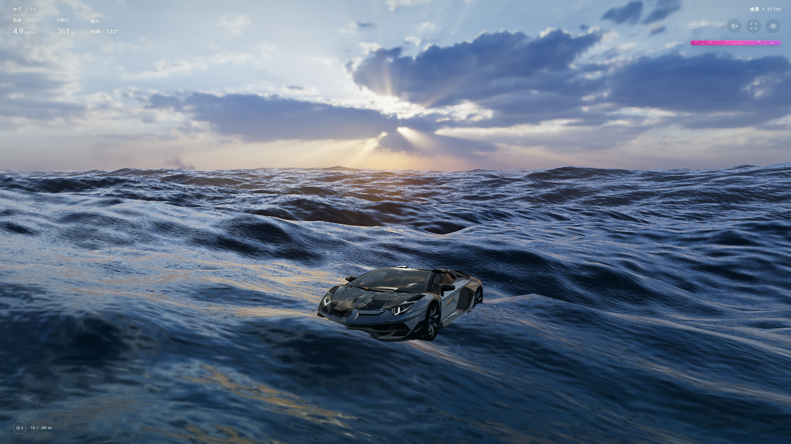
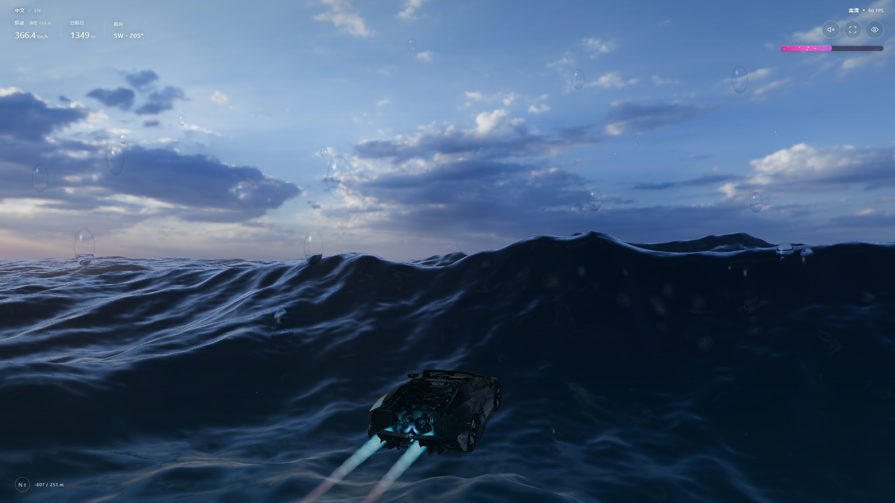
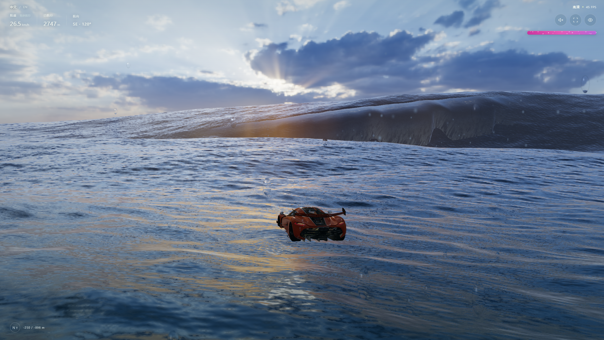
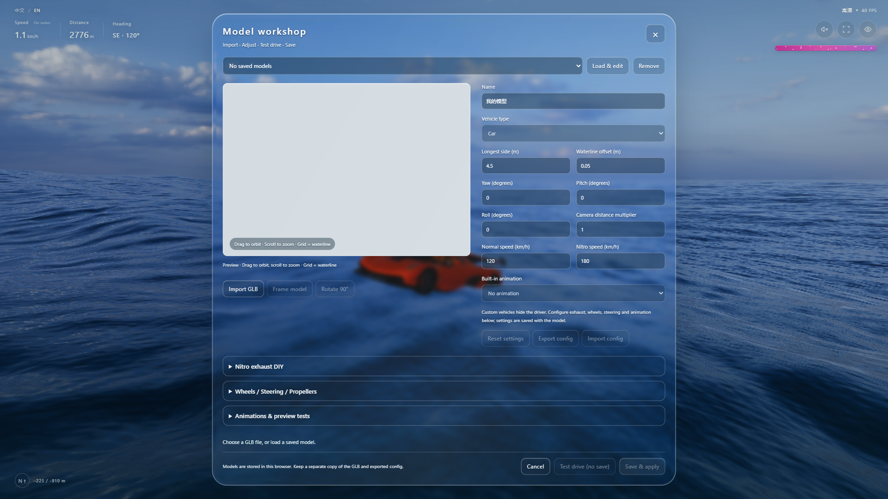

# TIDAL — Ocean Driving

A browser-based ocean-driving game with boats, personal watercraft, cars, large waves, jumps, underwater travel, nitro boost and a local GLB model workbench.

[English](#tidal--ocean-driving) · [简体中文](#潮汐-tidal)

| Sunset ocean driving / 夕阳航行 | Nitro boost / 氮气加速 |
| :---: | :---: |
|  |  |
| **Breaking waves / 翻卷海浪** | **GLB model workbench / GLB 模型调试台** |
|  |  |

In-game screenshots containing third-party vehicles and characters; see [MODEL_CREDITS.md](MODEL_CREDITS.md). The screenshots do not grant additional rights to the depicted assets.

Maintainer: [lingziyu186-coder](https://github.com/lingziyu186-coder).

## Download and play (Windows 10/11)

[Download ZIP](https://github.com/lingziyu186-coder/Tidal-drive/archive/refs/heads/main.zip)

1. Download the ZIP, choose **Extract All**, and open the extracted `Tidal-drive-main` folder.
2. Double-click **START-TIDAL.cmd**. Your default browser opens the game automatically.
3. Press **Space** on the cover to start.

**Keep the TIDAL command window open while playing.** You can minimise it; close it when finished. Closing it stops the local server, so vehicles that have not loaded yet will no longer load.

No Python, Node.js, commands or administrator rights are required. Windows PowerShell serves the extracted folder over local HTTP, accessible only from this computer. Use a browser with WebGL support; other operating systems need their own static HTTP server.

Once extracted, game resources load locally without GitHub or ChatGPT sign-in. If system policy blocks the launcher, contact the maintainer rather than disabling protection.

## Running and controls

The game starts with **2 · Sea-Doo**. Click the game view to focus it, then press a vehicle's number key on the main keyboard, or press **F** and select it in settings:

| Key | Vehicle | Key | Vehicle |
| --- | --- | --- | --- |
| `1` | Wooden rowboat | `5` | Mercedes AMG GT3 |
| `2` | Sea-Doo | `6` | Xiaomi SU7 Ultra |
| `3` | Kawasaki | `8` | Koenigsegg Jesko |
| `4` | Assault Boat | `9` | Aventador |

Built-in cars load when selected; no manual import is needed. **My Models** stores custom GLBs, so an empty library does not mean built-in vehicles are missing. Mazda (`7`), LEGO (`0`), the cat and its motions are excluded because redistribution permissions were not verified. Keys are not renumbered.

- **W/S**: forward/back; **A/D**: steer; **E/Shift**: nitro boost.
- **Space**: surface drift or underwater recovery; **C**: stop; **R**: reset.
- **F**: settings; **F11**: fullscreen; **Esc**: cover; **Space on the cover**: start/continue.
- **F → My Models**: import and edit a custom GLB. Keep your original GLB and exported configuration; the model library is stored in the current browser.

If the launcher closes immediately, confirm that you extracted the entire ZIP and that `START-TIDAL.cmd`, `Start-Tidal.ps1` and `index.html` are in the same folder. If a vehicle fails to load, first check that the TIDAL command window is still running and `models/` is intact, then restart the launcher and reload the page. These checks do not cover every possible loading failure.

## Attribution and licensing

- [CREDITS.md](CREDITS.md): dependencies, adaptations, asset sources and research references.
- [MODEL_CREDITS.md](MODEL_CREDITS.md): creators, sources, licences, changes and hashes for the eight shipped GLBs; the rowboat is procedural.
- [THIRD_PARTY_NOTICES.md](THIRD_PARTY_NOTICES.md), [RDEV_GLASS_NOTICE.md](RDEV_GLASS_NOTICE.md) and [licenses/](licenses/): retained third-party notices and licence texts.
- [LICENSE_SCOPE.md](LICENSE_SCOPE.md): terms for each part; the mixed `game.bundle.js` is not uniformly MIT-licensed.
- [REMIX_POLICY_DRAFT.md](REMIX_POLICY_DRAFT.md): proposed credited, noncommercial remix terms for material the maintainer may license. **The draft is not effective** and does not restrict third-party MIT, CC BY or CC0 permissions.

Vehicles `6`, `8` and `9` are recorded under CC BY-NC-SA 4.0: see their notices for attribution, changes, noncommercial use and ShareAlike. Free of charge does not automatically mean noncommercial. Original third-party licence texts govern their material.

Third-party work is credited to its creators; no author or brand endorsement is implied. Importing a model does not grant redistribution rights.

## Files and verification limits

This **web runtime package** contains the launcher, HTML/CSS/JavaScript, models, four screenshots, notices and [release-manifest.json](release-manifest.json). Keep them together. It is not the full development source project; do not launch `index.html` through `file:`.

The manifest lists file sizes and SHA-256 hashes, excluding itself. Hashes verify consistency, not freedom from bugs or vulnerabilities. Previous checks do not establish compatibility with every vehicle, setting, browser or GPU.

Asset records do not independently verify uploader, brand, livery, design or likeness rights. Report problems through [GitHub Issues](https://github.com/lingziyu186-coder/Tidal-drive/issues).

---

# 潮汐 TIDAL

浏览器海面驾驶游戏：支持木船、摩托艇和汽车，以及巨浪、飞跃、潜水、氮气加速和本地 GLB 模型调试。

[English](#tidal--ocean-driving) · [简体中文](#潮汐-tidal)

上方图集为实机截图，包含第三方载具与人物，来源见 [MODEL_CREDITS.md](MODEL_CREDITS.md)。截图不额外授予其中素材的使用权。

维护者：[lingziyu186-coder](https://github.com/lingziyu186-coder)。

## 下载即玩（Windows 10/11）

[下载 ZIP](https://github.com/lingziyu186-coder/Tidal-drive/archive/refs/heads/main.zip)

1. 下载 ZIP，选择**全部解压缩**，打开解压后的 `Tidal-drive-main` 文件夹。
2. 双击 **START-TIDAL.cmd**，默认浏览器会自动打开游戏。
3. 在封面按**空格键**开始。

**游玩时请保留 TIDAL 黑色启动窗口。** 可以最小化，结束后再关闭。关闭窗口会停止本机服务，尚未加载的载具将无法继续加载。

无需安装 Python、Node.js，无需输入命令或使用管理员权限。Windows PowerShell 为解压目录提供仅本机可访问的 HTTP 服务。浏览器需支持 WebGL；其他操作系统需自行提供静态 HTTP 服务。

完整解压后，资源从本机加载，无需登录 GitHub 或 ChatGPT。如果系统策略阻止启动，请联系维护者，不要关闭安全防护。

## 运行与操作

游戏默认使用 **2 · Sea-Doo 摩托艇**。先点击游戏画面，再按主键盘上的载具数字键，或按 **F** 在设置中选择：

| 按键 | 载具 | 按键 | 载具 |
| --- | --- | --- | --- |
| `1` | 木船 | `5` | Mercedes AMG GT3 |
| `2` | Sea-Doo | `6` | 小米 SU7 Ultra |
| `3` | Kawasaki | `8` | Koenigsegg Jesko |
| `4` | Assault Boat | `9` | Aventador |

内置汽车在切换时加载，**不需要手动导入**。“我的模型”存放自定义 GLB，列表为空不代表缺少内置载具。Mazda（`7`）、LEGO（`0`）、猫咪及其动作因再分发权限未核实而未随包，编号不重排。

- **W/S**：前后；**A/D**：转向；**E/Shift**：氮气加速。
- **Space**：水面漂移或水下上浮；**C**：停车；**R**：复位。
- **F**：设置；**F11**：全屏；**Esc**：封面；**封面 Space**：开始/继续。
- **F → 我的模型**：导入、编辑自定义 GLB。请另存原始 GLB 和导出的配置，模型库保存在当前浏览器中。

若启动窗口闪退，先确认已完整解压 ZIP，且 `START-TIDAL.cmd`、`Start-Tidal.ps1` 和 `index.html` 位于同一文件夹。若载具加载失败，先检查 TIDAL 启动窗口是否仍在运行、`models/` 是否完整，再重新启动并刷新页面。这些步骤不能涵盖所有加载失败原因。

## 来源、借鉴与许可

- [CREDITS.md](CREDITS.md)：依赖、改编、素材来源与研究参考。
- [MODEL_CREDITS.md](MODEL_CREDITS.md)：随包 8 个 GLB 的作者、来源、许可、改动与哈希；木船为程序化几何。
- [THIRD_PARTY_NOTICES.md](THIRD_PARTY_NOTICES.md)、[RDEV_GLASS_NOTICE.md](RDEV_GLASS_NOTICE.md) 和 [licenses/](licenses/)：保留的第三方声明与许可正文。
- [LICENSE_SCOPE.md](LICENSE_SCOPE.md)：各部分适用条款；混合代码 `game.bundle.js` 不是统一 MIT 许可。
- [REMIX_POLICY_DRAFT.md](REMIX_POLICY_DRAFT.md)：针对维护者有权授权材料的署名、非商业二创候选条款。**草案尚未生效**，不会收紧第三方 MIT、CC BY 或 CC0 权限。

载具 `6`、`8`、`9` 的许可记录为 CC BY-NC-SA 4.0，署名、改动、非商业和同许可要求见相应声明。免费不自动等于非商业。第三方原许可正文适用于对应材料。

第三方作品署名归其创作者，不暗示作者或品牌为项目背书。导入模型不等于取得再分发权限。

## 文件与检查边界

这是**网页运行包**，包含启动器、HTML/CSS/JavaScript、模型、四张截图、声明和 [release-manifest.json](release-manifest.json)。请保留文件的相对位置。它不是完整开发源码工程，请勿通过 `file:` 直接运行 `index.html`。

清单记录文件大小和 SHA-256，不包含清单自身。哈希用于核对一致性，不代表没有错误或漏洞。先前检查也不等于所有载具、设置、浏览器和显卡均已验证兼容。

素材记录不等于独立核实上传者、品牌、涂装、设计或肖像等权利。可通过 [GitHub Issues](https://github.com/lingziyu186-coder/Tidal-drive/issues) 反馈问题。
